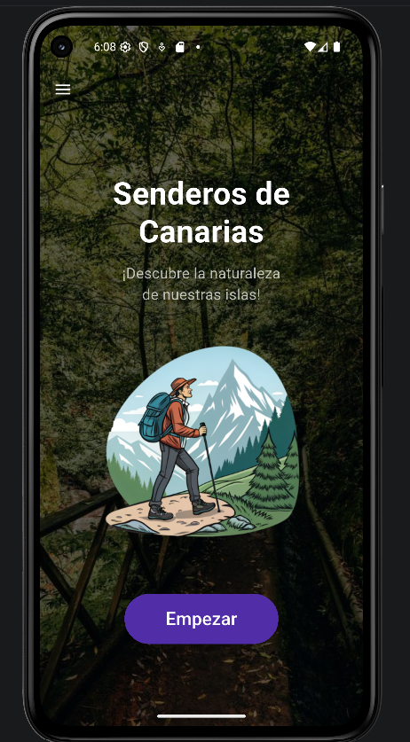
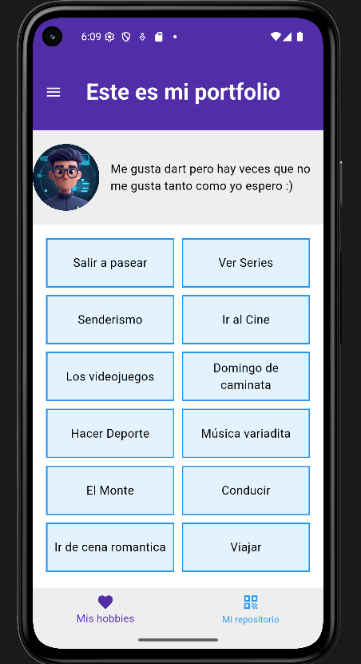
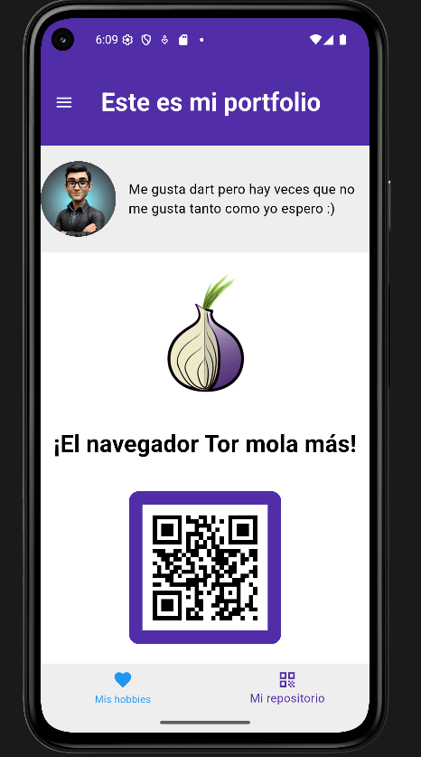
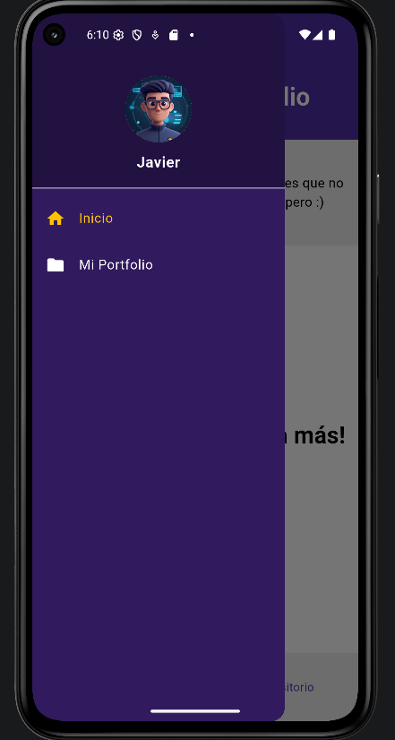

### Capturas de la Aplicación

Aquí se muestran las diferentes pantallas implementadas con la navegación mediante Drawer y BottomNavigationBar:

### Vista de la Pantalla de Inicio

### Vista de Mis Hobbies

### Vista de Mi Repositorio

### Vista del Drawer
